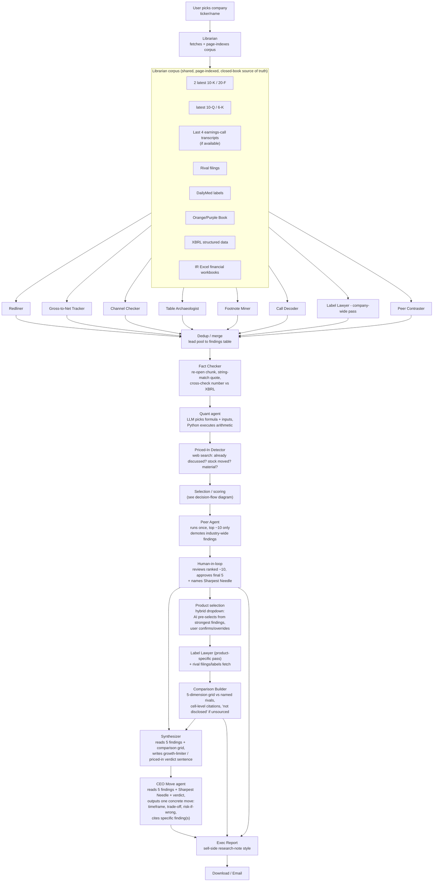
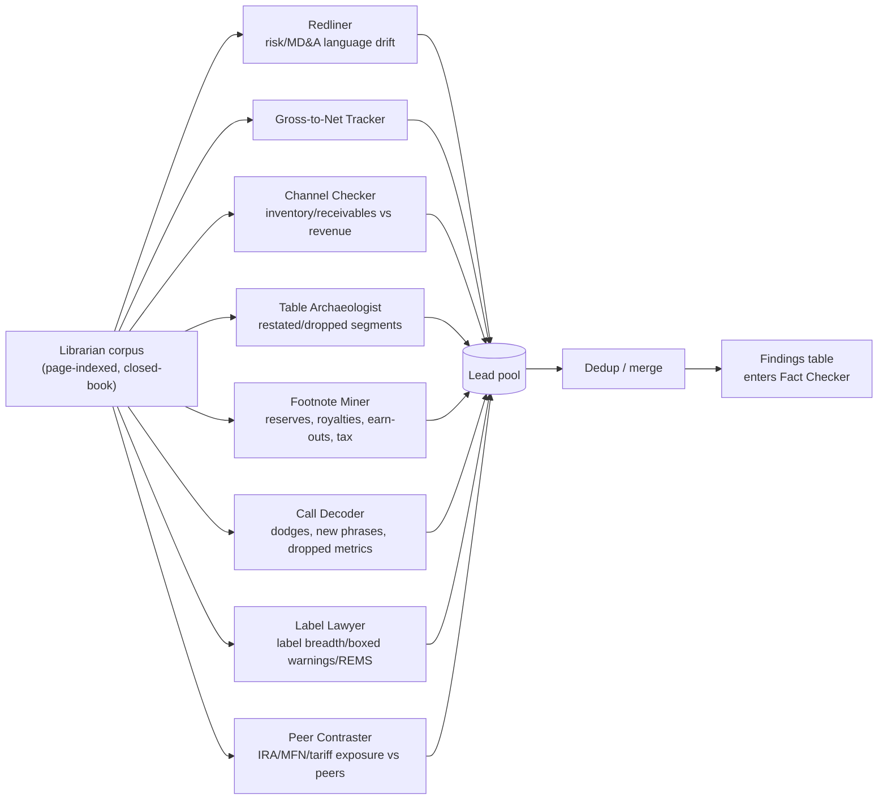
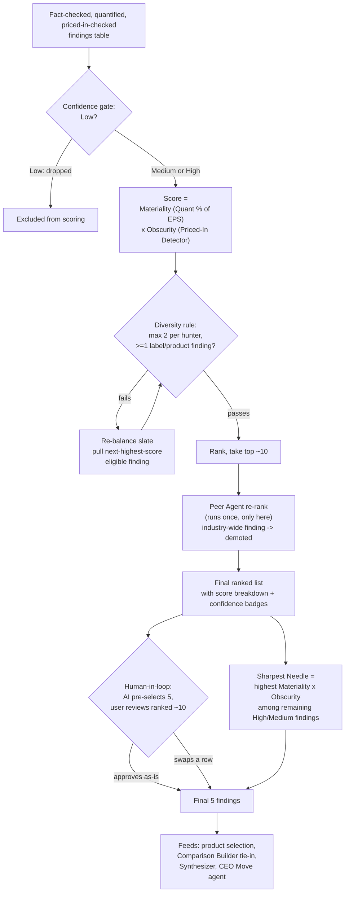

# Architecture: AI Agent Team for Pharma Analyst Work

> **Status: design only — nothing implemented yet.**
> This document is derived entirely from the brainstorming session log at
> `_bmad-output/brainstorming/brainstorm-ai-agent-pharma-analyst-team-2026-10-17/.memlog.md`.
> It describes the agreed architecture for the Neeley AI Forward Advanced Track
> submission. No code, prompts, or infrastructure exist yet — this is the spec
> to build against.

---

## 1. Overview & Goal

**Case:** Neeley AI Forward, Advanced Track ("The Fine Print: Find the Story,
Then Make the Call"). Pick one shortlisted pharma company, find material and
*not-obvious* findings in its own filings and its rivals' fine print, name a
"Sharpest Needle," build a 5-dimension product comparison against named
rivals, then take the CEO's seat and commit to one strategic move.

**Core design emphasis:** the system should do the actual analyst work — not
just move data through a slick UI. Every output must be traceable to a real
filing page or transcript quote. The product surface (dropdowns, download,
email) is secondary to the evidence pipeline underneath it.

**Design is intended to be reusable** across the 10 shortlist companies
(Merck, BMS, Pfizer, Eli Lilly, Novo Nordisk, AbbVie, J&J, AstraZeneca, Amgen,
Gilead) without per-company hardcoding, since the Librarian step is
parameterized by ticker/company.

**Non-goals established during the session:**
- Not a "Phone-a-Friend" role-play of hypothetical stakeholders — that idea
  was tried and dropped as too speculative; its intent was absorbed into the
  concrete, filing-grounded **Priced-In Detector** instead.
- Not dependent on earnings-call transcripts being available — the system
  must degrade gracefully (see §7).
- Not a system that trusts model memory for any fact — every number/quote
  must resolve to a real source chunk (see §4).

---

## 2. Design Principles

These were the load-bearing decisions that shape every stage below:

| Principle | Statement |
|---|---|
| **Closed-book citation** | Hunter agents may only cite chunk IDs from the Librarian's indexed corpus. They never pull facts from model memory/training data. A citation is a chunk ID, which is mechanically re-openable and checkable. |
| **Number-tie rule** | Every figure must be verified in **two independent primary sources** (e.g., XBRL structured tag + filing narrative text) before it can be marked **High** confidence. One-source numbers cap at Medium. |
| **Web search is not evidence** | Web/news search is used *only* to answer "has this already been said/priced in?" (Priced-In Detector). It is never used to source or confirm a fact or figure — search result snippets are confirmed-unreliable (see §7, "search-summary trap"). |
| **Confidence is earned, not self-reported** | A hunter proposing a finding does not get to assign its own confidence. A separate Fact Checker re-opens the citation and independently verifies it; confidence is a function of that re-check, not of the hunter's self-assessment. |
| **Graceful degradation** | If a required source category is unavailable for a given company (transcripts being the known risk), the dependent agent is marked "skipped: source unavailable" and the pipeline continues; it does not block or fabricate. |
| **Run expensive agents less** | Agents that are costly to run many times (Peer Agent) are deliberately sequenced *after* deduplication and first-pass ranking, operating only on the surviving top ~10 candidates, not the full lead pool. |
| **Human-in-the-loop at the irreversible step** | The AI pre-selects and pre-ranks, but a human approves the final 5 findings and the product choice before downstream stages (comparison, synthesis, CEO move, report) consume them. |

---

## 3. End-to-End Pipeline

### 3.1 Stage list (in order)

| # | Stage | Agent(s) | Cardinality |
|---|---|---|---|
| 0 | Source acquisition & indexing | **Librarian** | 1, runs once per company |
| 1 | Parallel candidate finding generation | **Hunter swarm** (8 hunters) | 8, run in parallel |
| 2 | Dedup/merge | Dedup/merge step | 1 |
| 3 | Independent verification | **Fact Checker** | runs per candidate |
| 4 | Impact quantification | **Quant agent** | runs per candidate |
| 5 | Priced-in / obscurity check | **Priced-In Detector** | runs per candidate |
| 6 | Scoring & ranking | **Selection/scoring logic** (code, not an agent persona) | 1 |
| 7 | Peer re-rank | **Peer Agent** | runs once, only on top ~10 |
| 8 | Human approval | Human-in-loop UI | 1 |
| 9 | Product selection | Hybrid dropdown (AI pre-select + user confirm) | 1 |
| 10 | Label/rival-specific hunting | **Label Lawyer** (+ rival fetch) | runs after product is fixed |
| 11 | Comparison build | **Comparison Builder** | 1 |
| 12 | Verdict synthesis | **Synthesizer** | 1 |
| 13 | Strategic recommendation | **CEO Move agent** | 1 |
| 14 | Report assembly | **Exec Report** generator | 1 |
| 15 | Delivery | Download / email | 1 |

### 3.2 Full pipeline diagram

### 3.3 Hunter-swarm fan-out / fan-in

All 8 hunters read the *same* Librarian corpus independently and in
parallel; none of them talk to each other; all of them funnel into a single
dedup/merge step that is the only point where overlapping leads are
reconciled before verification begins.

---

## 4. Agent Roster

### 4.0 Librarian

- **Role:** Given a company ticker/name, auto-fetches the exact source set
  the case requires and builds a single page-indexed, chunked corpus shared
  by every downstream agent.
- **Inputs:** Company identifier; (optionally) the chosen rival/competitive
  set once known.
- **Outputs:** Page-indexed corpus (chunk ID → doc, page, span) plus a
  **source manifest**: every doc logged with URL, accession number, filing
  date, fiscal period, doc type. Manifest is surfaced to the user as a "what
  we read" panel.
- **Source set it must acquire:**
  - 2 latest annual reports (10-K or 20-F)
  - latest quarterly report (10-Q, or 6-K for foreign private issuers)
  - last 4 earnings-call transcripts (by date — see §7)
  - rival filings (for Peer Contraster and Peer Agent)
  - rival labels (for Label Lawyer)
  - DailyMed labels (filtered to the actual labeler, latest SPL version)
  - Orange Book (small molecules) / Purple Book (biologics)
  - XBRL structured company facts
  - IR Excel financial workbooks (product × region quarterly sales) — identified
    as a high-value structured source alongside XBRL, especially for
    gross-to-net and channel analysis
- **Correctness checks:** flags wrong fiscal year, 10-K/A amendments, stale
  label versions; must follow "incorporated by reference" exhibits rather
  than trusting the primary filing document alone (see §8 gotchas).

### 4.1 Hunter Swarm (8 agents, parallel, closed-book)

Each hunter reads **only** the Librarian corpus — never outside knowledge —
and proposes candidate findings with a citation (chunk ID) for every claim.

| Hunter | "Where findings hide" category | Looks for |
|---|---|---|
| **Redliner** | Language drift | Diffs this year's vs. last year's Risk Factors / MD&A paragraph-by-paragraph; flags new, longer, or softened language |
| **Gross-to-Net Tracker** | Gross-to-net | Widening gap between list price and net price |
| **Channel Checker** | Inventory/receivables vs. revenue | Inventory or receivables growing faster than revenue (softening demand, pre-launch stocking, channel stuffing) |
| **Table Archaeologist** | Segment/product table changes | Restated or dropped prior-period numbers, products quietly no longer broken out |
| **Footnote Miner** | Footnotes | Litigation reserves, partner royalty splits, earn-out/acquisition payments, tax-rate changes |
| **Call Decoder** | Earnings-call Q&A | Deflected questions, new phrases, metrics the company stopped reporting |
| **Label Lawyer** | Product fine print | Label breadth, boxed warnings, REMS requirements vs. rivals (runs a company-wide pass early; a second, product-specific pass runs after product selection, §6) |
| **Peer Contraster** | Peer contrast | Company's differential exposure to IRA/MFN/tariffs vs. shortlist peers |

- **Scope dependency:** Librarian coverage must satisfy every hunter's
  needs, including peer companies' filings (Peer Contraster) and rival
  labels (Label Lawyer) — this pushed cross-company fetching earlier into
  the pipeline than a naive single-company design would.

### 4.2 Dedup / Merge

- **Role:** Collapse overlapping leads raised by multiple hunters into one
  findings-table row before verification, so the same underlying fact isn't
  fact-checked, quantified, and scored multiple times.
- **Inputs:** Raw lead pool from all 8 hunters.
- **Outputs:** Deduplicated findings table.

### 4.3 Fact Checker

- **Role:** Re-verification, not re-discovery, and explicitly **not** web
  search. Re-opens the exact cited chunk, exact string-matches the quote,
  and cross-checks any number + fiscal period against XBRL structured data.
- **Inputs:** One candidate finding (claim + citation chunk ID).
- **Outputs:** Verification verdict:
  - **Verbatim match + math reproduces** → eligible for **High**
  - **Partial match** → **Medium**
  - **Can't locate / doesn't reproduce** → **Low**, or dropped
- **This is where confidence is actually assigned** — hunters do not
  self-report confidence.

### 4.4 Quant agent

- **Role:** Turns a verified lead into a reproducible impact estimate
  (revenue / operating income / EPS).
- **Mechanism:** LLM selects the inputs and the formula (written out,
  auditable); a Python execution step actually does the arithmetic, so the
  number in the final table is computed, not generated.
- **Inputs:** Verified finding + relevant structured financials.
- **Outputs:** $ impact estimate, formula shown, inputs shown.

### 4.5 Priced-In Detector

- **Role:** Determines obscurity — whether the finding is already known to
  the market. This is the **only** place web/news search is used, and it is
  explicitly never used as factual evidence.
- **Checks:**
  1. Has anyone already said this? (earnings-call Q&A, news, sell-side notes)
  2. Did the stock move on the disclosure date?
  3. Is it material? (revenue/EPS math, fed by Quant agent output)
- **Outputs:** An obscurity signal feeding directly into scoring (§5) and
  into the product-fine-print "is it priced in?" verdict sentence required
  by the case.
- **Lineage note:** this agent is the concrete, evidence-grounded
  replacement for an earlier, rejected "Phone-a-Friend" role-play panel idea
  (sell-side analyst / PM / physician / payer / ex-employee / IR personas).
  The intent — "would this survive scrutiny from someone who already knows
  the space" — survives here as a real check against real external signals
  instead of simulated personas.

### 4.6 Peer Agent

- **Role:** Dedicated peer-comparison pass used as a **ranking signal**: if
  a finding turns out to be industry-wide (true at every shortlist peer, not
  distinctive to this company), it gets demoted rather than discarded.
- **When it runs:** Deliberately placed *after* dedup and the first-pass
  ranking, operating only on the **top ~10** surviving candidates — chosen
  specifically to minimize how many times this (expensive) agent has to run.
- **Inputs:** Top ~10 ranked findings + rival filings from the Librarian corpus.
- **Outputs:** Uniqueness/demotion signal that feeds back into final ranking
  before the human sees the shortlist.

### 4.7 Comparison Builder

- **Role:** Builds the 5-dimension product comparison grid required by the
  case, strictly from sourced data.
- **Grid dimensions:** uses (approved indications), boxed warnings/safety
  fine print, dosing/convenience, patent/exclusivity timeline, pricing &
  gross-to-net exposure.
- **Sourcing rule:** every cell cites a label section or Orange/Purple Book
  entry; a cell that cannot be sourced shows **"not disclosed"** rather than
  a guess.
- **Deliberately excludes:** the verdict/tie-in sentence — kept out of this
  agent so the grid stays pure sourcing and any interpretive claim stays
  separately traceable (see Synthesizer below).

### 4.8 Synthesizer

- **Role:** A **separate** step (not the Comparison Builder itself) that
  reads the approved comparison grid *and* the 5 approved findings, and
  writes the one-sentence growth-limiter / priced-in verdict the case
  requires ("what actually limits the product's growth, and whether the
  market has already priced it in").
- **Why separate:** keeps the Comparison Builder's output pure sourcing,
  while keeping the verdict traceable back to specific findings rather than
  baked silently into the grid-building step.

### 4.9 CEO Move agent

- **Role:** A **separate stage** from the Synthesizer (explicitly decided,
  not merged). Reads the final 5 approved findings, the named Sharpest
  Needle, and the Synthesizer's verdict sentence, and outputs **one**
  concrete recommended strategic move.
- **Output must include:**
  - A specific action (not "investigate further")
  - A timeframe
  - The trade-off
  - Downside / risk if wrong
  - Citations back to the specific finding(s) that justify it
- **Inputs:** 5 approved findings, Sharpest Needle, Synthesizer verdict.

### 4.10 Exec Report

- **Role:** Assembles everything into a single sell-side-style research
  note. User decision: this must read like a real analyst deliverable, not
  a skimmable internal brief.
- **Required structure:**
  - Masthead (branded, analyst-note style)
  - Thesis paragraph, with the Sharpest Needle as the headline call
  - 5 numbered findings, each with a confidence badge and footnote
  - Comparison table (from Comparison Builder)
  - Boxed callout for the CEO-move recommendation
  - Footnotes in **plain text** — filing name + page number — **no
    hyperlinks** (explicit user decision)
- **Delivery:** download and email.

---

## 5. Selection & Scoring Logic

Selection is implemented as **code applying a judge's rubric**, not a model
free-associating a ranking. The same scoring mechanism that ranks findings
is what produces the Sharpest Needle — it isn't a separate judgment call.

### 5.1 Rubric

1. **Confidence gate:** findings marked **Low** confidence by the Fact
   Checker are excluded outright. Only Medium/High proceed.
2. **Score = Materiality × Obscurity**
   - *Materiality* = Quant agent's $ impact estimate, expressed as a % of
     EPS (or equivalent).
   - *Obscurity* = inverse of Priced-In Detector hits — zero hits in
     calls/news ⇒ high obscurity score.
3. **Diversity rule:** cap of 2 findings per hunter in the final slate, and
   require at least 1 label/product finding so the findings table ties
   into the required product comparison.
4. **Peer re-rank:** Peer Agent runs on the top ~10 and demotes any finding
   shown to be industry-wide across shortlist peers rather than distinctive
   to this company.
5. **Sharpest Needle** = the highest Materiality × Obscurity score among
   remaining High/Medium-confidence findings, *after* peer demotion.
6. **Human-in-loop:** UI shows the ranked top ~10 with score breakdown and
   confidence badges; AI pre-selects 5; the human can swap any of them.
   Each row displays *why* it was picked (the score components).

### 5.2 Rejected/retired scoring ideas (recorded for traceability)

- User initially proposed ranking on: Financial Impact, Customer
  Confidence, Stakeholder Confidence, Employee Well-being, Future Output.
- Customer/Stakeholder/Employee-well-being criteria were dropped from
  Part 1 scoring: they are not measurable from filings (would require
  unverifiable LLM guessing) and don't serve the "not obvious" requirement.
  They were re-mapped instead to Part 2's "Why it will work" section (the
  CEO Move agent's audience of doctors/patients/payers/regulators/investors).
- "Future Output" (time horizon) was dropped outright as a 5th criterion.

### 5.3 Selection decision-flow diagram

---

## 6. Product Selection (Hybrid Timing)

- **Cascading structure:** Company → Product (from the case appendix's
  competitive set) → rivals auto-filled but editable (the case explicitly
  allows justified extra competitors).
- **Hybrid timing logic (key insight):** most hunters run **company-wide**
  regardless of product — only Label Lawyer and the rival-filings fetch are
  genuinely product-specific. So the app does **not** block on product
  choice up front:
  1. User picks company.
  2. Company-wide hunters run (all 8, including a company-wide Label Lawyer
     pass).
  3. App **pre-selects** a product in the dropdown based on which product
     the strongest surviving findings cluster around.
  4. User confirms or overrides.
  5. Only then do Label Lawyer's product-specific pass and the rival
     filing/label fetch run, feeding the Comparison Builder.
- This ordering avoids redundant fetching/hunting under multiple products
  and keeps the expensive, rival-aware work minimal.

---

## 7. Transcript Availability & Graceful Degradation

Earnings-call transcripts were identified early as the single biggest
sourcing risk in the entire pipeline — confirmed by live checks (§8) and by
explicit user judgment that transcript availability **cannot be assumed**
across the 10 shortlist companies.

- **Reality found:** transcripts are not on EDGAR, are often paywalled, and
  company IR sites vary — some post webcast recordings but not transcripts.
  Third-party transcript sources (roic.ai, Earnings Whispers, Quartr,
  allmind.ai, Fintool) exist but are gated/return 403 to automated fetching.
- **"Last 4 transcripts" is a moving, date-computed window**, not a fixed
  list — the pipeline must compute which 4 calls are the most recent as of
  run date, since a new quarter rolls the oldest one off (e.g., for Novo as
  of 2026-10-17: Q3 2025, Q4/FY2025, Q1 2026, Q2 2026 — Q3 2026 due ~early
  Nov 2026 would roll Q3 2025 off).
- **Decision: transcripts are optional, not required.**
  - Librarian attempts auto-fetch.
  - If that fails, the user is offered a manual upload path.
  - If neither succeeds, **Call Decoder is marked "skipped: no
    transcripts available"** and that coverage gap is shown in the UI.
  - Critically: **findings from the other 7 hunters are unaffected** — the
    pipeline does not block, stall, or degrade other agents' output because
    one source category is missing.

---

## 8. Live Data-Source Gotchas (Discovered During Session, Novo Nordisk Case)

These were surfaced doing a live check against real EDGAR/XBRL/DailyMed/
Orange Book data for Novo Nordisk, and generalize into Librarian design
rules — not illustrative examples, actual verified findings:

| Gotcha | What was found | Design implication |
|---|---|---|
| **20-F has no financials inline** | Novo's 20-F primary document incorporates the Annual Report **by reference** as a separate exhibit (`nvo-20251231_d2.htm`, ~10MB) | Librarian must follow incorporation-by-reference exhibits, not just parse the primary filing document |
| **Foreign filers use 6-K, not 10-Q** | Novo does not file a 10-Q; quarterly data arrives as a 6-K (e.g., Q2 2026 filed 2026-08-04, `caq22026.htm`) | Librarian must treat 6-K as the 10-Q equivalent for foreign private issuers |
| **XBRL taxonomy/currency mismatch for peer comps** | Novo's XBRL companyfacts uses `ifrs-full` taxonomy, DKK currency, annual granularity only | Peer comparison against USD/US-GAAP filers (e.g., Eli Lilly) requires an explicit FX conversion step *and* a taxonomy field-mapping step (e.g., IFRS "Revenue" vs. US-GAAP "Revenues") — this is unresolved engineering work, flagged as an open risk |
| **DailyMed returns noise** | Querying semaglutide returned 9 SPLs including repackagers (e.g., A-S Medication) with stale 2020–2024 dates | Librarian must filter to the actual original labeler (Novo) and select the latest SPL version, not just "first result" |
| **Orange Book worked cleanly** | Semaglutide compound patent 8129343 expires 2031-12-05; Ozempic-specific patents run to 2041; exclusivities run 2027–2029 | No special handling needed beyond normal parsing |
| **IR has workbooks, not transcripts** | Novo IR publishes investor presentations and quarterly Excel financial workbooks (strong structured source for product-level sales/gross-to-net) but **no call transcripts** | Confirms IR Excel workbooks as a first-class Librarian source; confirms transcript gap must be handled via §7 |
| **Search-summary trap** | A web search summary stated Q2 adjusted sales +7% CER; the actual 6-K table showed **reported** net sales +3% CER — a reported-vs-adjusted mismatch baked into the search snippet | Reinforces the number-tie rule: search output is never trusted as a number source, ever, for any purpose except priced-in detection |
| **Stale lead risk / point-in-time sensitivity** | FY2025 10-K-equivalent showed trade receivables **-1.5%** YoY (a true but, it turned out, stale signal); the subsequent Q2 2026 6-K showed receivables **+25.5%** in 6 months — the newest filing flips the Channel Checker lead entirely | A finding's confidence/freshness must account for filing recency and potential seasonality; Librarian/Fact Checker should flag when a more recent filing exists that could invalidate an older-filing-derived finding |

**General implications for the architecture:**
- The Librarian's fetch logic cannot be a one-size-fits-all SEC-only
  assumption — it must branch per filer type (domestic 10-K/10-Q vs. foreign
  20-F/6-K).
- Peer comparison across currency/taxonomy boundaries (DKK/IFRS vs. USD/
  US-GAAP) is a real, unresolved piece of engineering, not a detail — it
  should be explicitly budgeted for in implementation.
- Every "illustrative" number used during brainstorming before live
  verification turned out to need correction once checked against the
  primary document — reinforcing why the Fact Checker stage cannot be
  skipped or weakened for speed.

---

## 9. Open Risks / Unknowns

These are unresolved as of session end and should be treated as the first
implementation risks to retire:

1. **Transcript sourcing** — no reliable automated fetch path exists for
   earnings-call transcripts; third-party providers are gated. Mitigation
   (optional upload, graceful skip) is designed but not implemented/tested.
2. **FX + taxonomy mapping for peer comparison** — comparing an IFRS/DKK
   filer (Novo) against a US-GAAP/USD filer (e.g., Lilly) requires currency
   conversion and XBRL concept mapping (e.g., `Revenue` vs. `Revenues`) that
   has not been designed in detail, only flagged.
3. **Label/SPL filtering heuristics** — DailyMed's "pick the real labeler's
   latest SPL" logic needs a concrete filtering rule (labeler identity +
   version/date) that was identified but not formally specified.
2. **Stale-vs-fresh filing conflicts** — no defined rule yet for how the
   Fact Checker or Channel Checker should handle a lead whose supporting
   figure is contradicted or reversed by a more recent filing (the
   receivables -1.5% → +25.5% flip). Needs an explicit recency/seasonality
   check, not just "use the latest filing."
4. **Diversity-rule rebalancing mechanics** — the rule (max 2 per hunter,
   ≥1 label/product finding) is specified, but the exact rebalancing
   algorithm when a slate fails the rule (which finding gets bumped, how
   ties are broken) is not fully specified.
5. **Dedup/merge algorithm** — agreed as a necessary step, but the matching
   logic (how "same underlying fact raised by two hunters" is detected) is
   not specified.
6. **Generalization beyond Novo Nordisk** — all live verification in this
   session was done against Novo Nordisk filings only; the per-filer-type
   branching (10-K/10-Q vs. 20-F/6-K) and taxonomy handling are designed
   generically but validated against exactly one company so far.
7. **Peer Agent scope at scale** — "top ~10" was chosen to bound Peer Agent
   cost, but the actual cost/latency budget and what happens if the peer
   universe itself has sourcing gaps (a rival's filings not fully indexed)
   is unaddressed.
8. **Report branding/format** — "sell-side research-note style" and
   "branded" were directional decisions; no concrete template/visual design
   has been produced yet.

---

## 10. Traceability Note

This architecture is the convergence point of the brainstorming session: the
full pipeline is fundamentally **an evidence pipeline with closed-book
citation discipline** (Librarian corpus → Hunters cite only chunk IDs → Fact
Checker independently re-verifies → Quant agent does real, reproducible
arithmetic). The abandoned "Phone-a-Friend" panel's intent survived as the
Priced-In Detector. The scoring system (Materiality × Obscurity, diversity
rule, Peer-Agent demotion) is, at bottom, one idea — *"big, and not already
known"* — expressed through several cooperating agents rather than one.
