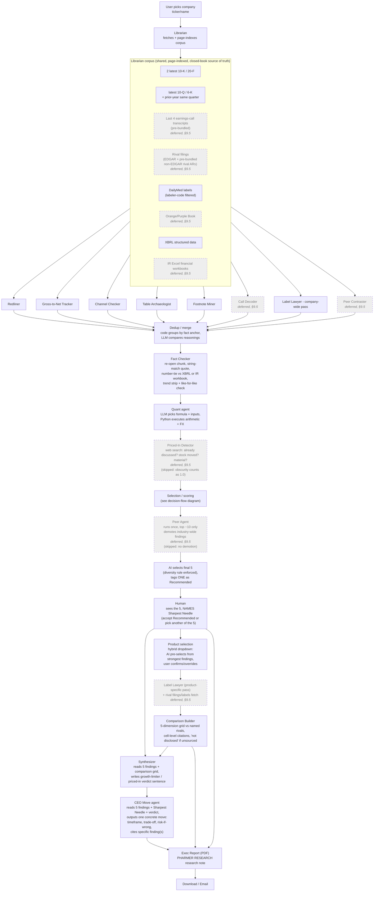
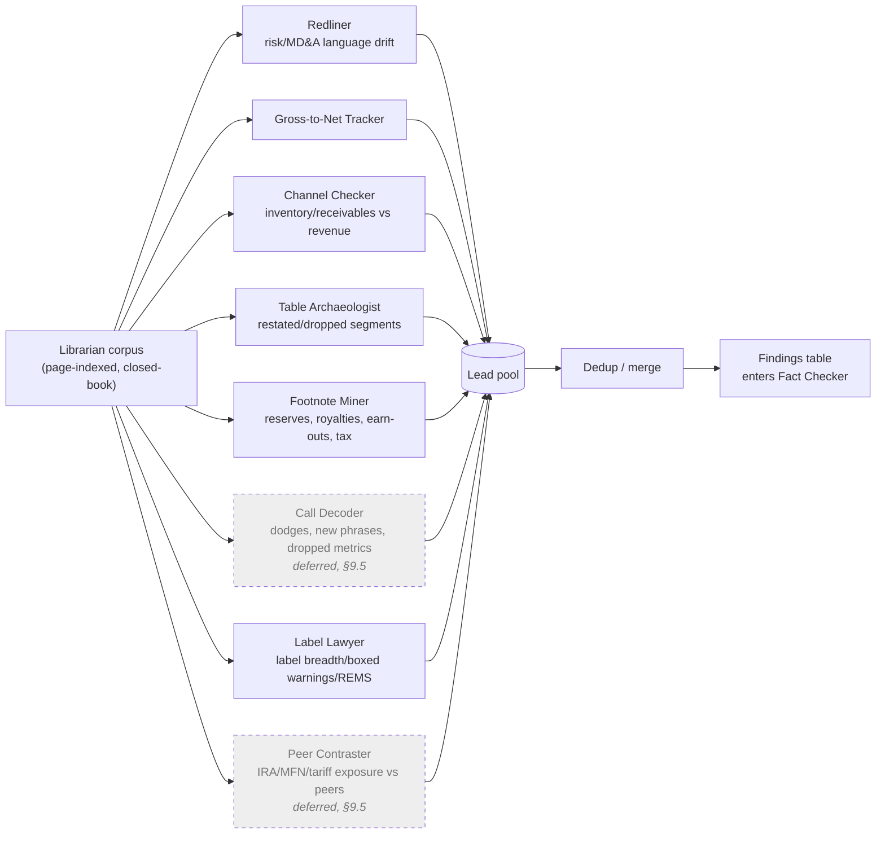
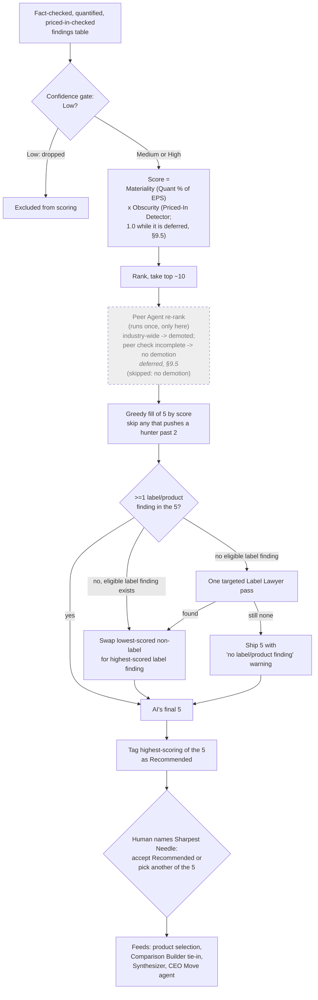

# Architecture: AI Agent Team for Pharma Analyst Work

> **Status: design target, partly built.** The pipeline runs end to end on
> `main` (checked against the code 2026-10-19), but several parts of this
> design are deferred or simplified. **§9.6 lists every difference between
> this design and the code**, and **`docs/stages.md` describes what each pipeline
> stage actually does** (inputs, outputs, model, checks). When this document and the
> code disagree, §9.6 says which one is current.
>
> This document was first derived from two brainstorming session logs:
> - `_bmad-output/brainstorming/brainstorm-ai-agent-pharma-analyst-team-2026-10-17/.memlog.md`
>   (pipeline design)
> - `_bmad-output/brainstorming/brainstorm-architecture-open-questions-2026-10-17/.memlog.md`
>   (resolution of every open question from the first session, plus a live
>   source probe across all 10 shortlist companies — script and raw results
>   in `source-probe/` next to that log)
>
> It describes the agreed architecture for the Neeley AI Forward Advanced Track
> submission, the spec the code was built against.

---

## 1. Overview & Goal

**Case:** Neeley AI Forward, Advanced Track ("The Fine Print: Find the Story,
Then Make the Call"). Pick one shortlisted pharma company, find material and
*not-obvious* findings in its own filings and its rivals' fine print, name a
"Sharpest Needle," build a 5-dimension product comparison against named
rivals, then take the CEO's seat and commit to one strategic move.

**Product name:** **Pharmer** (Pharmacy + Farmer). Reports carry the masthead
**PHARMER RESEARCH** — *"We find the needle in the haystack."* The filings are
the haystack; the Sharpest Needle is the needle.

**Core design emphasis:** the system should do the actual analyst work — not
just move data through a slick UI. Every output must be traceable to a real
filing page or transcript quote. The product surface (dropdowns, download,
email) is secondary to the evidence pipeline underneath it.

**Presentation mode: live demo on a judge-picked company.** A judge names any
of the 10 shortlist companies (Merck, BMS, Pfizer, Eli Lilly, Novo Nordisk,
AbbVie, J&J, AstraZeneca, Amgen, Gilead) and the pipeline runs on it live.
Generalization across all 10 is therefore **must-work, not nice-to-have**: the
Librarian is parameterized by ticker/company with no per-company hardcoding
beyond small, hand-verified lookup tables (§2, "Curate the small fixed
things").

**Non-goals established during the sessions:**
- Not a "Phone-a-Friend" role-play of hypothetical stakeholders — that idea
  was tried and dropped as too speculative; its intent was absorbed into the
  concrete, filing-grounded **Priced-In Detector** instead.
- Not dependent on live transcript fetching — transcripts are pre-bundled and
  the system degrades gracefully without them (see §7).
- Not a system that trusts model memory for any fact — every number/quote
  must resolve to a real source chunk (see §4).

---

## 2. Design Principles

These were the load-bearing decisions that shape every stage below:

| Principle | Statement |
|---|---|
| **Closed-book citation** | Hunter agents may only cite chunk IDs from the Librarian's indexed corpus. They never pull facts from model memory/training data. A citation is a chunk ID, which is mechanically re-openable and checkable. |
| **Number-tie rule** | Every figure must be verified in **two independently produced artifacts** before it can be marked **High** confidence. One-source numbers cap at Medium. The rule's job is to catch *our own extraction errors* (wrong column, wrong period, thousands vs. millions, adjusted vs. reported) — not to prove the company truthful, since every source is company-prepared. Default pair: filing table + XBRL tag. Where XBRL is unavailable (foreign filers' quarterly figures, §8), **filing table + IR Excel workbook** is an accepted pair. |
| **Web search is not evidence** | Web/news search is used *only* to answer "has this already been said/priced in?" (Priced-In Detector). It is never used to source or confirm a fact or figure — search result snippets are confirmed-unreliable (see §8, "search-summary trap"). |
| **Confidence is earned, not self-reported** | A hunter proposing a finding does not get to assign its own confidence. A separate Fact Checker re-opens the citation and independently verifies it; confidence is a function of that re-check, not of the hunter's self-assessment. |
| **Conflicts are findings, not noise** | When the data disagrees with itself — a newer filing reverses an older one, or two hunters read the same number two ways — the conflict is kept and surfaced as part of the finding rather than resolved away. Reversals and contested readings are often the least obvious (highest-obscurity) stories. |
| **Curate the small fixed things once; automate the open-ended things** | Small, stable lookups that automation gets wrong — the US-GAAP↔IFRS concept map, each company's NDC labeler codes, the non-EDGAR rival annual reports, transcripts — are hand-built/hand-collected once, verified, and reused for every run. Open-ended work (hunting, verification, quantification) is automated. |
| **Graceful degradation** | If a required source category is unavailable for a given company, the dependent agent is marked "skipped: source unavailable" and the pipeline continues; it does not block or fabricate. |
| **Run expensive agents less** | Agents that are costly to run many times (Peer Agent) are deliberately sequenced *after* deduplication and first-pass ranking, operating only on the surviving top ~10 candidates, not the full lead pool. |
| **AI selects, human names the needle** | The AI selects the final 5 findings and tags **one** of them **Recommended** (its suggested Sharpest Needle). The human sees the 5 and names the Sharpest Needle — accepting the Recommended one or choosing a different one of the 5. The human also confirms the product, and resolves any ambiguous label match (§4.0). Those are the only three human pause points. |

---

## 3. End-to-End Pipeline

### 3.1 Stage list (in order)

| # | Stage | Agent(s) | Cardinality |
|---|---|---|---|
| 0 | Source acquisition & indexing | **Librarian** | 1, runs once per company |
| 1 | Parallel candidate finding generation | **Hunter swarm** (8 hunters) | 8, run in parallel |
| 2 | Dedup/merge | Dedup/merge step (code + LLM judge) | per fact-anchor group |
| 3 | Independent verification | **Fact Checker** | runs per candidate |
| 4 | Impact quantification | **Quant agent** | runs per candidate |
| 5 | Priced-in / obscurity check | **Priced-In Detector** *(deferred, §9.5)* | runs per candidate |
| 6 | Scoring & ranking | **Selection/scoring logic** (code, not an agent persona) | 1 |
| 7 | Peer re-rank | **Peer Agent** *(deferred, §9.5)* | runs once, only on top ~10 |
| 8 | Final 5 + Sharpest Needle | AI selects 5 and tags one Recommended; **human names the Sharpest Needle** | 1 |
| 9 | Product selection | Hybrid dropdown (AI pre-select + user confirm) | 1 |
| 10 | Label/rival-specific hunting | **Label Lawyer** (+ rival fetch) | runs after product is fixed |
| 11 | Comparison build | **Comparison Builder** | 1 |
| 12 | Verdict synthesis | **Synthesizer** | 1 |
| 13 | Strategic recommendation | **CEO Move agent** | 1 |
| 14 | Report assembly | **Exec Report** generator (PDF) | 1 |
| 15 | Delivery | Download / email | 1 |

### 3.2 Full pipeline diagram

In the code, DailyMed labels (C5) exist only in the prebuilt NVO corpus
(`data/sample/NVO`); a live Librarian run fetches SEC filings and XBRL only
(§9.6).

### 3.3 Hunter-swarm fan-out / fan-in

All 8 hunters read the *same* Librarian corpus independently and in
parallel; none of them talk to each other; all of them funnel into a single
dedup/merge step that is the only point where overlapping leads are
reconciled before verification begins. (For the hackathon build, Call Decoder
and Peer Contraster are deferred, so 6 hunters run; dashed boxes, §9.5.)

### 3.4 Execution model & run-time budget

Because the demo is live, run time is a design constraint.

- **Pipelining (decided, not built — §9.6):** stages do not run as batches. Each candidate
  flows into Fact Checker → Quant → Priced-In Detector **as soon as it
  emerges** from Dedup, so verification overlaps with hunting.
  One barrier is unavoidable: scoring and the Peer Agent need the **full**
  candidate pool, since findings can't be ranked until all exist.
- **Model tiering (decided):** a faster, cheaper model for the mechanical
  stages (Dedup judge, Fact Checker, Quant formula selection); the strongest
  model for the hunters, Synthesizer, and CEO Move agent.
- **Estimated budget (reasoned before the build; not yet replaced by measured
  timings — `pipeline.json` records real per-stage seconds per run):**

| Stage | Estimate (stage-by-stage design) | What drives it |
|---|---|---|
| Librarian (cold) | 2–4 min | ~20–30 docs; SEC ~10 req/s; parsing + indexing ~1M tokens |
| 8 hunters (parallel) | 4–8 min | 5–15 tool turns each × 10–30s; wall time = slowest hunter |
| Dedup | 0.5–1 min | grouping is code; LLM per group, parallel |
| Fact Checker | 1–2 min | mostly code; LLM only on partial matches |
| Quant | 1–2 min | LLM formula choice + Python, parallel |
| Priced-In Detector | 2–4 min | web search + price check per candidate; most variable stage |
| Scoring | <1 sec | code |
| Peer Agent (top ~10) | 1–2 min | rival filings already indexed |
| Human pauses | ~1–2 min | Sharpest Needle, product confirm, possible label resolution |
| Label Lawyer product pass + Comparison Builder | 2–4 min | 4–5 labels; ~20 grid cells in parallel |
| Synthesizer + CEO Move + Report | 2–4 min | short inputs; ~3–5k tokens of report output + PDF render |
| **Total** | **~20–35 min** cold | **~13–22 min** with pipelining + model tiering |

- **Fallback lever (not yet adopted):** pre-cache the full Librarian corpus
  for all 10 companies, removing the 2–4 min cold fetch. Decide after real
  timings are measured in the Stage-2 golden runs (§9.2).

---

## 4. Agent Roster

This section is the design of each agent. For what each pipeline stage does
in the code today (files read and written, model, validation, gaps), see
`docs/stages.md`. In the code, only the hunters are agents (tool loops); the
other stages are code with fixed single Claude calls or no call at all.

### 4.0 Librarian

- **Role:** Given a company ticker/name, auto-fetches the exact source set
  the case requires and builds a single page-indexed, chunked corpus shared
  by every downstream agent.
- **Inputs:** Company identifier; (optionally) the chosen rival/competitive
  set once known.
- **Outputs:** Page-indexed corpus (chunk ID → doc, page, span) plus a
  **source manifest**: every doc logged with URL, accession number, filing
  date, fiscal period, doc type, and whether it was fetched live or
  **pre-collected** (with source URL + collection date). Manifest is surfaced
  to the user as a "what we read" panel.
- **Source set it must acquire:**
  - 2 latest annual reports (10-K or 20-F)
  - latest quarterly report (10-Q, or 6-K for foreign private issuers)
  - **prior-year same-quarter quarterly report** — needed because quarterly
    balance sheets compare only against the last year-end, so like-for-like
    seasonality checks on balance-sheet items (receivables, inventory) need
    the year-ago filing (§4.3)
  - last 4 earnings-call transcripts (pre-bundled — see §7)
  - rival filings (for Peer Contraster and Peer Agent) — from EDGAR, or from
    the **pre-bundled pinned corpus** for rival makers not on EDGAR (§8.2)
  - rival labels (for Label Lawyer)
  - DailyMed labels (selected by the label rule below)
  - Orange Book (small molecules) / Purple Book (biologics)
  - XBRL structured company facts
  - IR Excel financial workbooks (product × region quarterly sales) — a
    first-class structured source, and the number-tie second source where
    XBRL has no quarterly data
- **Filer-type branching:** domestic 10-K/10-Q vs. foreign 20-F/6-K. For
  foreign filers:
  - follow "incorporated by reference" exhibits (Novo's annual report lives
    in a separate exhibit);
  - identify the **financial** 6-Ks by reading content — not by file name or
    filer-agent accession prefix, both of which vary (§8).
- **Fiscal-period matching:** match quarters by fiscal period (FY/FQ), never
  by calendar date — Pfizer and J&J use 52/53-week quarters
  (2026-06-28 vs. 2025-06-29).
- **Label rule (DailyMed SPL selection):**
  1. Get the product's NDA/BLA number from the Orange Book / Purple Book
     (trade-name lookup must be prefix/fuzzy — e.g., `CABENUVA KIT`).
  2. Pull every DailyMed SPL filed under that application.
  3. Keep only SPLs whose **NDC labeler code** is on the hand-verified
     per-company allowlist (§8.2 — several codes per company). Company names
     can't be used: Novo appears as three different names across SEC, Orange
     Book, and DailyMed, while repackagers carry the *same* NDA number.
  4. Take the latest published version.
  5. **Zero or multiple survivors → pause and ask the human** to pick
     (candidates shown with title, date, labeler). No auto-pick: a wrong
     label would silently corrupt every Comparison Builder cell.
  - DailyMed is the **only** label source. openFDA was tested and rejected
    as a backup (missing Novo's own Ozempic injection SPL; mis-tagged a
    combined Ozempic/Rybelsus entry).
- **Purple Book access:** monthly CSV download; scrape the link from the
  downloads page rather than constructing the URL (month capitalization is
  inconsistent).
- **Correctness checks:** flags wrong fiscal year, 10-K/A amendments, stale
  label versions.

### 4.1 Hunter Swarm (8 agents, parallel, closed-book)

Each hunter reads **only** the Librarian corpus — never outside knowledge —
and proposes candidate findings with a citation (chunk ID) for every claim.

| Hunter | "Where findings hide" category | Looks for |
|---|---|---|
| **Redliner** | Language drift | Diffs this year's vs. last year's Risk Factors / MD&A paragraph-by-paragraph; flags new, longer, or softened language |
| **Gross-to-Net Tracker** | Gross-to-net | Widening gap between list price and net price |
| **Channel Checker** | Inventory/receivables vs. revenue | Inventory or receivables growing faster than revenue (softening demand, pre-launch stocking, channel stuffing) |
| **Table Archaeologist** | Segment/product table changes | Restated or dropped prior-period numbers, products quietly no longer broken out |
| **Footnote Miner** | Footnotes | Litigation reserves, partner royalty splits, earn-out/acquisition payments, tax-rate changes |
| **Call Decoder** *(deferred, §9.5)* | Earnings-call Q&A | Deflected questions, new phrases, metrics the company stopped reporting |
| **Label Lawyer** | Product fine print | Label breadth, boxed warnings, REMS requirements vs. rivals (runs a company-wide pass early; a second, product-specific pass runs after product selection, §6) |
| **Peer Contraster** *(deferred, §9.5)* | Peer contrast | Company's differential exposure to IRA/MFN/tariffs vs. shortlist peers |

- **Scope dependency:** Librarian coverage must satisfy every hunter's
  needs, including peer companies' filings (Peer Contraster) and rival
  labels (Label Lawyer) — this pushed cross-company fetching earlier into
  the pipeline than a naive single-company design would.
- **Turn cap:** hunters run with a bounded number of tool turns so one slow
  hunter can't stall the run (exact cap set during build).

### 4.2 Dedup / Merge

- **Role:** Collapse overlapping leads raised by multiple hunters before
  verification, so the same underlying fact isn't fact-checked, quantified,
  and scored multiple times — **without** collapsing genuinely different
  stories about that fact.
- **Two-level model:**
  - **Fact anchor** — the raw observation: metric + entity + fiscal period
    (e.g., "Novo trade receivables, +25.5%, H1 2026"). Verified **once** by
    the Fact Checker no matter how many hunters cite it.
  - **Reasoning** — the causal claim built on the anchor (e.g., "demand
    softening" vs. "payer-rebate timing"). Different reasonings can carry
    very different business impact, so each is quantified and scored on its
    own.
- **Algorithm (hybrid):**
  1. **Code** groups leads by fact anchor (deterministic match on metric +
     entity + period).
  2. **LLM judge** compares reasonings *only within* each group.
  3. Same anchor + same reasoning → merged into one, all contributing
     hunters credited.
  4. Same anchor + different reasonings → one **composite row**.
- **Composite row:** one issue, N reasoning bullets, each with its own
  citations, **its own confidence and its own Quant impact** (so a
  High-confidence harmless reading can't lend credibility to a
  Medium-confidence damaging one). The row's ranking score = its strongest
  reasoning. When reasonings contradict each other, the anchor is flagged
  **"contested"** — a signal for the reviewer in itself.
- **Split option:** composite by default; any reasoning can be promoted to a
  standalone finding. Sibling reasonings of one anchor **may both** occupy
  slots in the final 5 — there is no one-slot-per-anchor cap.
- **Inputs:** Raw lead pool from all 8 hunters.
- **Outputs:** Deduplicated findings table (single rows + composite rows).

### 4.3 Fact Checker

- **Role:** Re-verification, not re-discovery, and explicitly **not** web
  search. Re-opens the exact cited chunk, exact string-matches the quote,
  and cross-checks any number + fiscal period against a second source.
- **Number-tie second source:** XBRL tag by default; **IR Excel workbook**
  when XBRL has no data for that figure (foreign filers' quarterly numbers).
  Filing table + workbook agreeing is sufficient for High.
- **Trend strip:** for every figure, pulls the **same metric across every
  period in the corpus** (e.g., FY24 → FY25 → Q1 → Q2) and attaches it to the
  finding, so a reversal is visible rather than detected by special-case
  rule.
- **Reversal handling:** when a newer filing reverses an older finding, the
  finding is **kept and recast with the reversal as the story** (e.g.,
  "receivables flipped from −1.5% to +25.5% in six months").
- **Seasonality check:** a flip is confirmed **like-for-like** (H1 2026 vs.
  H1 2025, using the prior-year same-quarter filing), not quarter-end vs.
  year-end. If like-for-like can't be confirmed (the comparable filing
  genuinely can't be found), the finding is **capped at Medium** and carries
  a **"possibly seasonal"** warning label.
- **Inputs:** One candidate finding (claim + citation chunk ID).
- **Outputs:** Verification verdict:
  - **Verbatim match + number-tie reproduces** → eligible for **High**
  - **Partial match** (or like-for-like unconfirmable) → **Medium**
  - **Can't locate / doesn't reproduce** → **Low**, or dropped
- **This is where confidence is actually assigned** — hunters do not
  self-report confidence.

### 4.4 Quant agent

- **Role:** Turns a verified lead into a reproducible impact estimate
  (revenue / operating income / EPS).
- **Mechanism:** LLM selects the inputs and the formula (written out,
  auditable); a Python execution step actually does the arithmetic, so the
  number in the final table is computed, not generated.
- **Currency rules:**
  - **Growth rates are quoted as the company discloses them** — reported
    growth plus the company's own constant-currency figure (Novo "CER",
    Lilly's FX-effect column). We never compute our own constant-currency
    growth: methodologies differ per company, so ours would create false
    mismatches against the filings.
  - **Our own FX conversion is used only for cross-company absolute-dollar
    comparisons** (absolute amounts are required in the deliverable; ratios
    alone are not enough). Source: **ECB reference rates** (free daily API;
    USD/DKK via the EUR cross rate). Flows (revenue, costs) at the
    **period-average** rate; balances (receivables, inventory) at the
    **period-end** rate (mirrors IAS 21 / ASC 830).
  - Always show **native + converted**, with the rate and date in the
    footnote — e.g., "DKK 69.6bn (≈ $10.8bn at 6.44 DKK/USD, ECB,
    30 Jun 2026)". The conversion runs in the Python step.
- **Taxonomy mapping:** a hand-built concept map of the ~20–30 metrics
  hunters actually use, US-GAAP ↔ IFRS (e.g., `Revenues` ↔ `Revenue`,
  `AccountsReceivableNetCurrent` ↔ `CurrentTradeReceivables`,
  `InventoryNet` ↔ `Inventories`). An unmapped metric falls back to the
  filing table (one fewer source → lower confidence ceiling) and is logged as
  **"unmapped metric"**; rows are added from that miss log during testing.
- **Inputs:** Verified finding + relevant structured financials.
- **Outputs:** $ impact estimate, formula shown, inputs shown.

### 4.5 Priced-In Detector

- **Role:** Determines obscurity — whether the finding is already known to
  the market. This is the **only** place web/news search is used, and it is
  explicitly never used as factual evidence.
- **Checks:**
  1. Has anyone already said this? (earnings-call Q&A, news, sell-side notes)
  2. Did the stock move on the disclosure date?
  3. Is it material? (revenue/EPS math, fed by Quant agent output)
- **Outputs:** An obscurity signal feeding directly into scoring (§5) and
  into the product-fine-print "is it priced in?" verdict sentence required
  by the case.
- **Lineage note:** this agent is the concrete, evidence-grounded
  replacement for an earlier, rejected "Phone-a-Friend" role-play panel idea
  (sell-side analyst / PM / physician / payer / ex-employee / IR personas).
  The intent — "would this survive scrutiny from someone who already knows
  the space" — survives here as a real check against real external signals
  instead of simulated personas.

### 4.6 Peer Agent

- **Role:** Dedicated peer-comparison pass used as a **ranking signal**: if
  a finding turns out to be industry-wide (true at every shortlist peer, not
  distinctive to this company), it gets demoted rather than discarded.
- **When it runs:** Deliberately placed *after* dedup and the first-pass
  ranking, operating only on the **top ~10** surviving candidates — chosen
  specifically to minimize how many times this (expensive) agent has to run.
  At ~1–2 min it is not the run-time bottleneck (§3.4).
- **Sourcing gaps:** if a rival's filings are missing from the corpus, the
  finding is marked **"peer check incomplete"** and is **not demoted**.
  Pre-bundling non-EDGAR rival annual reports (§8.2) keeps this rare.
- **Inputs:** Top ~10 ranked findings + rival filings from the Librarian corpus.
- **Outputs:** Uniqueness/demotion signal that feeds back into final ranking
  before the AI selects the final 5.

### 4.7 Comparison Builder

- **Role:** Builds the 5-dimension product comparison grid required by the
  case, strictly from sourced data.
- **Grid dimensions:** uses (approved indications), boxed warnings/safety
  fine print, dosing/convenience, patent/exclusivity timeline, pricing &
  gross-to-net exposure.
- **Sourcing rule:** every cell cites a label section (label chosen by the
  §4.0 label rule) or an Orange/Purple Book entry; a cell that cannot be
  sourced shows **"not disclosed"** rather than a guess.
- **Deliberately excludes:** the verdict/tie-in sentence — kept out of this
  agent so the grid stays pure sourcing and any interpretive claim stays
  separately traceable (see Synthesizer below).

### 4.8 Synthesizer

- **Role:** A **separate** step (not the Comparison Builder itself) that
  reads the approved comparison grid *and* the 5 approved findings, and
  writes the one-sentence growth-limiter / priced-in verdict the case
  requires ("what actually limits the product's growth, and whether the
  market has already priced it in").
- **Why separate:** keeps the Comparison Builder's output pure sourcing,
  while keeping the verdict traceable back to specific findings rather than
  baked silently into the grid-building step.

### 4.9 CEO Move agent

- **Role:** A **separate stage** from the Synthesizer (explicitly decided,
  not merged). Reads the final 5 findings, the named Sharpest Needle, and the
  Synthesizer's verdict sentence, and outputs **one** concrete recommended
  strategic move.
- **Output must include:**
  - A specific action (not "investigate further")
  - A timeframe
  - The trade-off
  - Downside / risk if wrong
  - Citations back to the specific finding(s) that justify it
- **Inputs:** Final 5 findings, Sharpest Needle, Synthesizer verdict.

### 4.10 Exec Report

- **Role:** Assembles everything into a single sell-side-style research
  note. User decision: this must read like a real analyst deliverable, not
  a skimmable internal brief.
- **Format:** **PDF.**
- **Required structure:**
  - Masthead: **PHARMER RESEARCH** — *"We find the needle in the
    haystack."* (Our own identity; must not imitate any real bank's research
    branding.)
  - Thesis paragraph, with the Sharpest Needle as the headline call
  - 5 numbered findings, each with a confidence badge and footnote
    (composite rows show each reasoning with its own badge; "contested" and
    "possibly seasonal" labels are carried through)
  - Comparison table (from Comparison Builder)
  - Boxed callout for the CEO-move recommendation
  - Footnotes in **plain text** — filing name + page number — **no
    hyperlinks** (explicit user decision)
- **Copy note:** avoid the word "pharming" (an existing term for GM
  organisms producing drugs, and a DNS phishing attack).
- **Delivery:** download and email.

---

## 5. Selection & Scoring Logic

Selection is implemented as **code applying a judge's rubric**, not a model
free-associating a ranking. The rubric selects the **final 5** and tags one
of them **Recommended** (the suggested Sharpest Needle). The human's decision
is which of those 5 is the Sharpest Needle.

### 5.1 Rubric

1. **Confidence gate:** findings marked **Low** confidence by the Fact
   Checker are excluded outright. Only Medium/High proceed.
2. **Score = Materiality × Obscurity**
   - *Materiality* = Quant agent's $ impact estimate, expressed as a % of
     EPS (or equivalent).
   - *Obscurity* = inverse of Priced-In Detector hits — zero hits in
     calls/news ⇒ high obscurity score.
   - Composite rows score as their strongest reasoning.
3. **Peer re-rank:** Peer Agent runs on the top ~10 and demotes any finding
   shown to be industry-wide across shortlist peers rather than distinctive
   to this company ("peer check incomplete" ⇒ no demotion).
4. **Diversity rule — applied to the AI's final 5 (hard rule):**
   - **Greedy fill by score:** walk down the ranked list, taking each
     finding unless it would push a hunter past **2** findings in the 5.
     Composite rows count only against the hunter behind their **lead
     reasoning**.
   - **Label guarantee:** if the 5 contain no label/product finding, swap
     out the **lowest-scored non-label** finding for the **highest-scored
     eligible label** finding.
   - **Tie-breaks:** higher confidence (High > Medium), then higher
     obscurity, then higher materiality. Obscurity outranks materiality
     because "not obvious" is the core of the case.
   - **No eligible label finding at all:** run **one** targeted Label Lawyer
     pass to look harder; if it still finds none, ship the 5 with a visible
     **"no label/product finding"** warning.
5. **Recommended tag:** the highest-scoring of the final 5 is tagged
   **Recommended** — the suggested Sharpest Needle.
6. **Human names the Sharpest Needle:** the UI shows the 5 with score
   breakdown, confidence badges, and the Recommended tag, plus *why* each was
   selected (the score components). The human accepts the Recommended
   finding or names a different one of the 5. The human does not change
   which 5 are selected.

### 5.2 Rejected/retired scoring ideas (recorded for traceability)

- User initially proposed ranking on: Financial Impact, Customer
  Confidence, Stakeholder Confidence, Employee Well-being, Future Output.
- Customer/Stakeholder/Employee-well-being criteria were dropped from
  Part 1 scoring: they are not measurable from filings (would require
  unverifiable LLM guessing) and don't serve the "not obvious" requirement.
  They were re-mapped instead to Part 2's "Why it will work" section (the
  CEO Move agent's audience of doctors/patients/payers/regulators/investors).
- "Future Output" (time horizon) was dropped outright as a 5th criterion.
- An interim design had the human select the final 5 from a ranked top ~10;
  superseded — the AI selects the 5, the human names the Sharpest Needle.

### 5.3 Selection decision-flow diagram

---

## 6. Product Selection (Hybrid Timing)

- **Cascading structure:** Company → Product (from the case appendix's
  competitive set) → rivals auto-filled but editable (the case explicitly
  allows justified extra competitors).
- **Hybrid timing logic (key insight):** most hunters run **company-wide**
  regardless of product — only Label Lawyer and the rival-filings fetch are
  genuinely product-specific. So the app does **not** block on product
  choice up front:
  1. User picks company.
  2. Company-wide hunters run (all 8, including a company-wide Label Lawyer
     pass).
  3. App **pre-selects** a product in the dropdown based on which product
     the strongest surviving findings cluster around.
  4. User confirms or overrides.
  5. Only then do Label Lawyer's product-specific pass and the rival
     filing/label fetch run, feeding the Comparison Builder. If the label
     rule (§4.0) can't resolve a single label for the product or a rival,
     the run pauses for the human to pick.
- This ordering avoids redundant fetching/hunting under multiple products
  and keeps the expensive, rival-aware work minimal.

---

## 7. Transcript Availability & Graceful Degradation

Earnings-call transcripts were identified early as the single biggest
sourcing risk in the entire pipeline — confirmed by live checks (§8) and by
explicit user judgment that transcript availability **cannot be assumed**
across the 10 shortlist companies.

- **Reality found:** transcripts are not on EDGAR, are often paywalled, and
  company IR sites vary — some post webcast recordings but not transcripts.
  Third-party transcript sources (roic.ai, Earnings Whispers, Quartr,
  allmind.ai, Fintool) exist but are gated/return 403 to automated fetching.
- **"Last 4 transcripts" is a moving, date-computed window**, not a fixed
  list — the pipeline must compute which 4 calls are the most recent as of
  run date, since a new quarter rolls the oldest one off (e.g., for Novo as
  of 2026-10-17: Q3 2025, Q4/FY2025, Q1 2026, Q2 2026 — Q3 2026 due ~early
  Nov 2026 would roll Q3 2025 off).
- **Decision: pre-bundle transcripts.** ~40 documents (10 companies × 4
  calls) are collected ahead of time — only from legitimately obtainable
  sources (company-IR-posted transcripts, our own access) — and loaded into
  the pinned corpus like any other source. Because the window rolls, the
  bundle is **re-collected shortly before demo day**.
- **Fallback chain at run time:**
  - Librarian attempts auto-fetch for anything fresher than the bundle.
  - Pre-bundled transcripts are used otherwise.
  - The user is offered a manual upload path for any gap.
  - If none succeeds, **Call Decoder is marked "skipped: no
    transcripts available"** and that coverage gap is shown in the UI.
  - Critically: **findings from the other 7 hunters are unaffected** — the
    pipeline does not block, stall, or degrade other agents' output because
    one source category is missing.

---

## 8. Live Data-Source Gotchas

Surfaced by live checks against real EDGAR / XBRL / DailyMed / openFDA /
Orange Book / Purple Book / IR data. These are verified findings, not
illustrative examples, and each one generalizes into a Librarian design
rule.

### 8.1 Novo Nordisk deep check (session 1, extended in session 2)

| Gotcha | What was found | Design implication |
|---|---|---|
| **20-F has no financials inline** | Novo's 20-F primary document incorporates the Annual Report **by reference** as a separate exhibit (`nvo-20251231_d2.htm`, ~10MB) | Librarian must follow incorporation-by-reference exhibits, not just parse the primary filing document |
| **Foreign filers use 6-K, not 10-Q** | Novo does not file a 10-Q; quarterly data arrives as a 6-K (e.g., Q2 2026 filed 2026-08-04, `caq22026.htm`) | Librarian must treat 6-K as the 10-Q equivalent for foreign private issuers |
| **Most 6-Ks are noise** | Novo filed 63 6-Ks in 2026 (buyback notices, press releases). The financial ones were filed under different filer-agent accession prefixes over time (Q2 2025 `caq22025.htm` via `0001628280`, Q2 2026 via `0000353278`) | Detect financial 6-Ks by content; never key on accession prefix |
| **No quarterly XBRL for foreign filers** | Novo's XBRL companyfacts is `ifrs-full`, DKK, **annual only** — no quarterly receivables. Lilly's (US-GAAP) includes 10-Q quarterly facts | For foreign filers' quarterly figures, the IR workbook is the number-tie second source (§2, §4.3); FX + concept mapping per §4.4 |
| **Prior-year same quarter is retrievable** | Novo's Q2 2025 6-K fetched fine: trade receivables DKK 69,575m (30 Jun 2025) vs. 71,949m (31 Dec 2024) | Like-for-like seasonality checks are feasible; prior-year quarter added to the source set |
| **DailyMed returns noise** | Ozempic returned SPLs from repackager A-S Medication (NDC `50090`) under the **same NDA 209637** as Novo's own (NDC `0169`) | Application number alone can't filter repackagers; filter by NDC labeler code (§4.0 label rule) |
| **One company, three names** | SEC: "NOVO NORDISK A S"; Orange Book applicant: "NOVO NORDISK INC"; DailyMed labeler: "NOVO NORDISK PHARMACEUTICAL INDUSTRIES, LP" | Never match entities by name; use labeler codes |
| **openFDA is unreliable** | openFDA's label API lacked Novo's own Ozempic injection SPL and mis-tagged a combined Ozempic/Rybelsus entry | DailyMed is the only label source |
| **Orange Book worked cleanly** | Semaglutide compound patent 8129343 expires 2031-12-05; Ozempic-specific patents run to 2041; exclusivities run 2027–2029 | Normal parsing (with fuzzy trade-name lookup, §8.2) |
| **IR has workbooks, not transcripts** | Novo IR publishes quarterly Excel financial workbooks (Q2 2025 → Q2 2026 confirmed downloadable as valid .xlsx) but **no call transcripts** | IR workbooks are a first-class source; transcripts handled via §7 |
| **Search-summary trap** | A web search summary stated Q2 adjusted sales +7% CER; the actual 6-K table showed **reported** net sales +3% CER — a reported-vs-adjusted mismatch baked into the search snippet | Search output is never trusted as a number source, for any purpose except priced-in detection |
| **Stale lead risk / point-in-time sensitivity** | FY2025 annual showed trade receivables **−1.5%** YoY; the Q2 2026 6-K showed receivables **+25.5%** in 6 months — the newest filing flips the Channel Checker lead entirely | Resolved by trend strip + reversal-as-story + like-for-like check (§4.3) |
| **FX rate source** | ECB data API returned official daily reference rates (e.g., DKK/EUR 7.4744 on 2026-06-30); FRED's CSV endpoint did not respond from the test machine | ECB is the FX source (§4.4) |

### 8.2 Ten-company source probe (session 2)

A throwaway probe ran the Librarian checklist against all 10 shortlist
companies, 11 rival makers, and all 45 products named in the case appendix.
**Result: no company blocks a live demo** — every company has its core
sources, and every appendix product was found on DailyMed and in the Orange
or Purple Book.

| Company | Filer | 2 annuals | Latest Q | Prior-yr Q | Quarterly XBRL | Currency | NDC labeler codes |
|---|---|---|---|---|---|---|---|
| Merck | 10-K/10-Q | ✅ | Q2 '26 | ✅ | ✅ | USD | 0006 |
| BMS | 10-K/10-Q | ✅ | Q2 '26 | ✅ | ✅ | USD | 0003 (as E.R. Squibb) |
| Pfizer | 10-K/10-Q | ✅ | Q2 '26 | ✅ (52/53-wk) | ✅ | USD | 0069 |
| Eli Lilly | 10-K/10-Q | ✅ | Q2 '26 | ✅ | ✅ | USD | 0002 |
| Novo Nordisk | 20-F/6-K | ✅ | Q2 '26 | ✅ | ❌ | DKK | 0169 |
| AbbVie | 10-K/10-Q | ✅ | Q2 '26 | ✅ | ✅ | USD | 0074 |
| J&J | 10-K/10-Q | ✅ | Q2 '26 | ✅ (52/53-wk) | ✅ | USD | 57894 (Janssen Biotech), 50458 (Janssen Pharma) |
| AstraZeneca | 20-F/6-K | ✅ | H1 '26 | ✅ | ❌ | USD (IFRS) | 0310 |
| Amgen | 10-K/10-Q | ✅ | Q2 '26 | ✅ | ✅ | USD | 72511 (Amgen USA), 55513 (Amgen Inc), 58406 (Immunex — Enbrel) |
| Gilead | 10-K/10-Q | ✅ | Q2 '26 | ✅ | ✅ | USD | 61958 |

| Gotcha | What was found | Design implication |
|---|---|---|
| **52/53-week fiscal quarters** | Pfizer and J&J quarters end 2026-06-28 vs. 2025-06-29; a calendar-date match reported their prior-year quarter as missing | Match by fiscal period, not date (§4.0) |
| **AstraZeneca 6-K naming is arbitrary** | 91 6-Ks in 2026; financial reports named `azn-20260630x6k.htm`, `a2999c.htm`, `tm…d1_6k.htm`; reports in USD under IFRS | Novo's `caq` naming is not a rule — content-based detection; AZ needs concept mapping but no FX |
| **Rival makers not on EDGAR** | Roche (Tecentriq), Boehringer Ingelheim (Jardiance; private), ViiV/Shionogi (Dovato, Cabenuva, Apretude) are not SEC registrants. Novartis, Sanofi, Takeda, GSK file 20-F/6-K; Regeneron, BridgeBio, Alnylam file 10-K/10-Q | Affects 4 of 10 demo companies (Merck, BMS, AZ, Gilead). **Pre-bundle** Roche and Boehringer annual reports; use GSK's 20-F for ViiV. Pinned docs are indexed and cited identically, marked "pre-collected" in the manifest; runtime fetch of a fresher copy is attempted first |
| **Multiple labeler codes per company** | J&J labels under two Janssen entities, Amgen under three (Enbrel as Immunex), BMS as E.R. Squibb | The labeler-code allowlist holds several codes per company |
| **Private-label co-labelers** | Humira also labeled by Cordavis; Amjevita by Nuvaila, which was the **only** labeler found for Wezlana; Praluent labeled by both Regeneron and Sanofi | Exactly the ambiguous cases the label rule's human-pick step resolves; Wezlana's labeler needs manual verification |
| **Orange Book trade-name suffixes** | Cabenuva is listed as `CABENUVA KIT` | Prefix/fuzzy trade-name lookup |
| **Naive substring matching misfires** | Searching SEC company names for "ROCHE" matched "SINOPEC SHANGHAI PETROCHEMICAL" | Entity resolution by identifier (CIK, ticker, labeler code), never substring |
| **Purple Book URLs inconsistent** | Monthly CSV names mix `january` and `February` casing | Scrape the link from the downloads page |

**General implications for the architecture:**
- The Librarian's fetch logic cannot be a one-size-fits-all SEC-only
  assumption — it branches per filer type (domestic 10-K/10-Q vs. foreign
  20-F/6-K) and falls back to the pinned corpus for non-EDGAR rivals.
- Every "illustrative" number used during brainstorming before live
  verification needed correction once checked against the primary
  document — and several of the probe's own first results were wrong
  (see §9.3) — reinforcing why the Fact Checker stage cannot be skipped or
  weakened for speed.

---

## 9. Resolved Decisions & Remaining Open Items

### 9.1 Resolution of the original open risks

All open risks from session 1 were resolved in session 2:

| Original open risk | Resolution | Where |
|---|---|---|
| Transcript sourcing | Pre-bundle ~40 transcripts from legitimate sources, re-collected before demo day; auto-fetch → bundle → upload → graceful skip | §7 |
| FX + taxonomy mapping | Company-disclosed growth/CER only; ECB conversion for cross-company $ (period-average flows, period-end balances, native + USD shown); hand-built ~20–30 metric concept map with miss log; IR workbook as number-tie second source when XBRL is absent | §2, §4.3, §4.4 |
| Label/SPL filtering heuristics | NDA/BLA → DailyMed → labeler-code allowlist → latest version → human pick on ambiguity; DailyMed only | §4.0 |
| Stale-vs-fresh filing conflicts | Trend strip; reversal kept as the story; like-for-like seasonality check with prior-year quarter added to sources; unconfirmable ⇒ Medium + "possibly seasonal" | §4.3 |
| Diversity-rule rebalancing | Hard rule on the AI's 5: greedy fill (max 2/hunter), label swap, tie-breaks, one targeted Label Lawyer retry then warning | §5.1 |
| Dedup/merge algorithm | Fact anchor + reasoning; code groups, LLM judges within group; composite rows with per-reasoning confidence/impact; "contested" flag; split option | §4.2 |
| Generalization beyond Novo | Live judge-picked demo ⇒ must-work. Stage-1 probe done on all 10 (all viable, fixes in §4.0/§8.2); Stage-2 plan below | §8.2, §9.2 |
| Peer Agent scope at scale | Stays top ~10; "peer check incomplete" ⇒ no demotion; pipelining + model tiering for run time | §3.4, §4.6 |
| Report branding/format | PHARMER RESEARCH masthead + tagline, PDF | §4.10 |

### 9.2 Testing plan

- **Stage 1 — source probe (done, pre-code):** verifies that the data exists
  and what shape it's in for every company. Script and results:
  `_bmad-output/brainstorming/brainstorm-architecture-open-questions-2026-10-17/source-probe/`.
- **Stage 2 — output quality (post-code):** a golden set of three
  archetypes — **Eli Lilly** (domestic, US-GAAP, USD), **Novo Nordisk**
  (foreign, IFRS, DKK), **AstraZeneca** (foreign, IFRS, USD). Measure real
  stage timings here (replacing §3.4 estimates) and collect the concept-map
  miss log.
- **Full dry run on all 10** before demo day, so judges can't pick a company
  that has never been run.

### 9.3 Recorded "AI was confidently wrong" cases

The case's How-we-did-it report requires at least one; the sessions produced
several, each caught by checking against the primary source:
- Search-summary trap: +7% adjusted vs. +3% reported (§8.1).
- openFDA was proposed as a backup label source, then retracted after it
  proved to be missing Novo's own Ozempic label (§8.1).
- The probe matched "Roche" to "Sinopec Shanghai Petrochemical" (§8.2).
- The probe reported Pfizer's and J&J's prior-year quarters as missing — a
  calendar-date matching bug, not a data gap (§8.2).

### 9.4 Remaining open items

1. **Presentation slot length** — unknown; determines whether the measured
   run time is acceptable or the pre-cache lever (§3.4) is needed.
2. **Real run time** — §3.4 is an estimate until Stage-2 runs.
3. **Concept-map coverage** — whether ~20–30 metrics suffice is validated
   by the miss log during testing.
4. ~~**Hunter turn cap** — exact value set during build.~~ Resolved: 15
   turns (`MAX_TURNS` in `pharmer/hunters/harness.py`, also stated in
   `prompts/hunter_rules.md`).
5. **Labeler allowlist completeness** — verify Wezlana's labeler (only
   Nuvaila found) and any other private-label cases by hand.
6. **Pre-bundle refresh** — re-collect transcripts and rival annual reports
   shortly before demo day; confirm each transcript source is legitimately
   usable.
7. **Report visual template** — branding and structure are fixed; the PDF's
   visual design is produced at build time.

### 9.5 Deferred for the hackathon deadline (decided 2026-10-18)

Cut to ship on time; the design above stays the target. In the diagrams
(§3.2, §3.3, §5.3) deferred parts are dashed grey boxes marked "deferred, §9.5". The
Priced-In Detector and Peer Agent are listed in `orchestrator.DISABLED_STAGES`:
they are never scheduled and `pipeline.json` records them as `disabled` with a
reason (any other missing stage module is recorded as "skipped: not built").
The fallbacks below are already in code.

| Deferred | Why it can wait | What runs instead |
|---|---|---|
| **Peer Agent** (§4.6) | No rival filings in the corpus yet, so every finding would be "peer check incomplete" (no demotion) anyway | Scoring treats peer as null ⇒ no demotion |
| **Peer Contraster** hunter | Same: needs rival filings | 6 of the 8 hunters run |
| **Call Decoder** hunter | No transcripts in the corpus; §7 already plans for their absence | Marked skipped, per §7 |
| **Priced-In Detector** (§4.5) | Verdict's priced-in call is written by the Synthesizer from the selected findings | Scoring counts unchecked as not priced in (obscurity 1.0), so ranking is by Materiality alone |
| Orange / Purple Book fetch | Only the patent/exclusivity row needs it | That row prints "not disclosed" (§4.7 rule) |
| Report polish: skipped-stage notes in the PDF, per-cell comparison footnotes, rivals field in the UI | Cosmetic / CLI `--rivals` works | Stage status in `pipeline.json`; cell sources in `comparison_sources.json` |

**Not deferred (ship path):** Label Lawyer hunter (the final 5 must hold a
label/product finding, §5.1 label guarantee), the Synthesizer's crash with
no API credential, Quant (Partner A), then one real end-to-end run. All four
are done (build log, 2026-10-18).

### 9.6 Where the code differs from this design (checked 2026-10-19)

This section lists every difference between the design above and the code on
`main`, including the §9.5 cuts and gaps that §9.5 does not record. Where this
section and the text above disagree, this section describes the code.
`docs/stages.md` has the per-stage detail.

| Design (section) | Code on `main` |
|---|---|
| 8 hunters (§3.1, §4.1) | 6 hunters: Channel Checker, Redliner, Table Archaeologist, Footnote Miner, Gross-to-Net Tracker, Label Lawyer. Call Decoder and Peer Contraster are not built. |
| Pipelining: each candidate flows on as soon as Dedup emits it (§3.4) | Not built. Stages run in order, and each one processes every finding before the next starts. |
| Librarian fetches labels, Orange/Purple Book, transcripts, rival filings and IR workbooks (§4.0) | A live run fetches SEC filings (10-K/10-Q or 20-F/6-K, prior-year quarter, incorporated exhibits) and XBRL only. DailyMed labels (Ozempic, Mounjaro) exist only in the prebuilt `data/sample/NVO` corpus, built by `scripts/build_sample_corpus.py` with the §4.0 label rule. `start --corpus` uses that corpus. |
| Manifest shown as a "what we read" panel (§4.0) | No panel in the UI. The PDF lists its sources, and the agent card shows a document count. |
| IR workbook as the second number-tie source (§2, §4.3) | Not built. A foreign filer's quarterly figure has no second source, so it reaches Medium at most, and Quant cannot compute its `eps_pct`, so it scores null. |
| Dedup "split option" (§4.2) | Not built. A composite row stays composite. |
| Quant shows native + converted amounts with the FX rate and date (§4.4) | Quant stores `usd_m`, `eps_pct`, `formula`, `inputs` and `fx`. The report prints only `usd_m` and `eps_pct`. The native amount is not in Contract 2. |
| Scoring takes the top ~10 for the Peer Agent (§5.1.3) | No top-10 cut, because the Peer Agent is disabled. Peer null means no demotion. A reasoning with no Quant impact scores null and ranks after every scored one. |
| One targeted Label Lawyer retry when no label finding exists (§5.1.4) | Not built. Scoring logs it, and the report prints the "no label/product finding" warning. |
| Product dropdown pre-selected by the AI (§6) | Not built. The dropdown lists the appendix products (`data/products.json`) and starts at "Not confirmed". Rivals can be set from the CLI only (`finish --rivals`); the UI shows the appendix rivals as text. |
| Label Lawyer product-specific pass + rival fetch after the pick (§6, stage 10) | Not built. Only the company-wide Label Lawyer pass runs, and the Comparison Builder works from the corpus's existing labels and filings. |
| Human picks a label when zero or several match (§4.0) | This happens when the sample corpus is built: the script stops instead of auto-picking. There is no run-time pause, because live runs fetch no labels. |
| Human must name the Sharpest Needle (§2, §5.1.6) | If no needle is named, CEO Move falls back to the Recommended finding and marks it `recommended_fallback`. The report says the needle was not confirmed. |
| Priced-in verdict (§4.5, §4.8) | With no priced-in check, the report prints "Market pricing not assessed" and states that the ranking is by materiality alone. The Synthesizer's prose may still allude to pricing (known limit, build log). |
| CEO Move output (§4.9) | As designed, plus a "why it works" field. There is no budget or rejected-alternatives field, which the case asks for. Adding them changes the output, so both partners must agree. |
| Report structure (§4.10) | As designed, plus an Executive Overview at the top and a "Coverage and limitations" section. The CEO box is headed "24-Month Strategic Move for the CEO". |
| Delivery: download and email (§3.1 stage 15, §4.10) | Download only (Streamlit UI). Email is not built. |
| UI (not specified above) | A Streamlit app (`app.py`), deployed on Render (`render.yaml`). It has a company grid, agent cards from `pipeline.json`, a review screen with the pick, and a result screen. The plan is in `docs/ui-plan.md`. |
| Run control (not specified above) | `orchestrator.py start` / `finish` split at the human pause. `pipeline.json` records each stage as `ok` / `degraded` / `skipped` / `disabled` / `failed`, with timings. Each stage writes an audit sidecar (`librarian_report.json`, `fact_check_report.json`, `quant_report.json`, `comparison_sources.json`). |

---

## 10. Traceability Note

This architecture is the convergence point of two brainstorming sessions:
the full pipeline is fundamentally **an evidence pipeline with closed-book
citation discipline** (Librarian corpus → Hunters cite only chunk IDs → Fact
Checker independently re-verifies → Quant agent does real, reproducible
arithmetic). The abandoned "Phone-a-Friend" panel's intent survived as the
Priced-In Detector. The scoring system (Materiality × Obscurity, diversity
rule, Peer-Agent demotion) is, at bottom, one idea — *"big, and not already
known"* — expressed through several cooperating agents rather than one.
Session 2 added a second through-line: **conflicts in the data are kept as
findings, and the small fixed lookups are curated by hand once** so the
open-ended automation can run on any of the 10 companies live.
